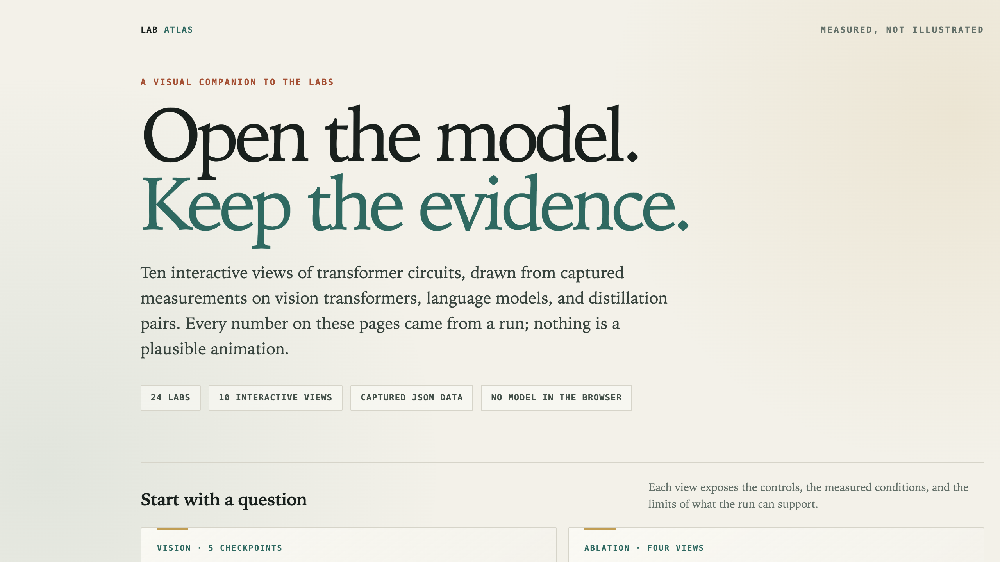
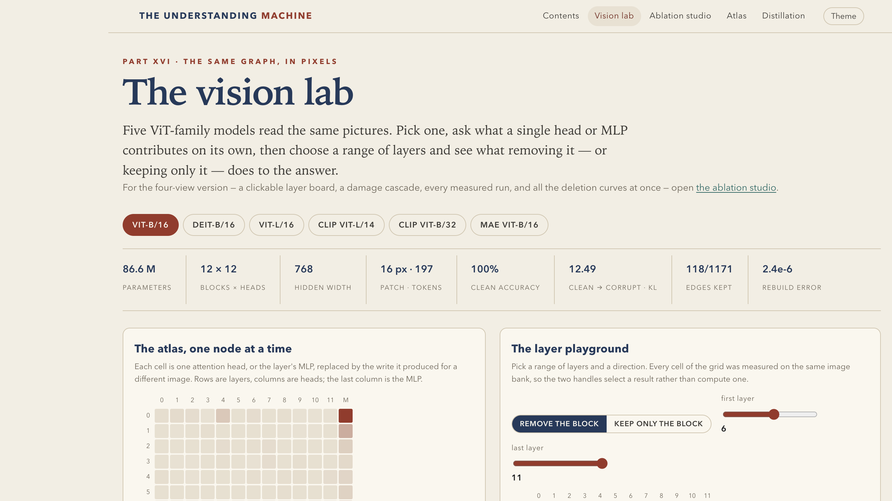

# Mechanistic Interpretability Lab Atlas

A reproducible set of **24 hands-on labs**, a **4,320-image InceptionV1 feature microscope**, and **eleven interactive measurement views** for opening up small neural networks: attention, induction heads, sparse autoencoders, probing, causal tracing, vision-language models, circuit discovery, distillation, and real-image neuron responses.

The interactive pages do not run models in the browser. They replay captured measurements — ablation KL, CKA matrices, attention patterns, per-layer residuals, and InceptionV1 channel activations — so a reader can inspect the evidence without a GPU.



## Start here

```bash
git clone <repository-url> understanding-machine-labs
cd understanding-machine-labs

python3 -m http.server 8000 --directory visualizations
```

Open <http://localhost:8000/>. The landing page links every interactive study. The pages must be served over HTTP; opening the HTML files directly blocks their data loads.

For the labs:

```bash
python3 -m venv .venv
source .venv/bin/activate
pip install -r requirements.txt
cd labs
python3 lab01_perceptron.py
```

Later labs load checkpoints produced by earlier ones. The captured reference outputs are in `labs/expected/`; the matching notebooks are in `labs/notebooks/`.

## Interactive views

Every view reads a captured data file from `visualizations/`.

| View | What you can inspect | Open |
|---|---|---|
| **Vision lab** | Every attention head and MLP in five ViT-family checkpoints; remove a node, a range of layers, or a whole block and read the answer damage. | [vision.html](visualizations/vision.html) |
| **Feature microscope** | All 512 channels of InceptionV1’s `inception4c` layer, plus selected channels in three more layers, ranked against 13,394 real photographs with spatial activation maps and channel statistics. | [microscope.html](visualizations/microscope.html) |
| **Ablation studio** | The same vision measurements four ways: layer board, damage cascade, contiguous runs, and deletion curves. | [studio.html](visualizations/studio.html) |
| **Activation atlas** | Clean forward-pass grids: variance-selected hidden dimensions, prompt attention, and next-token distributions. | [atlas.html](visualizations/atlas.html) |
| **Language panel** | Mean-ablate one head, MLP, or layer in GPT-2 and inspect the next-token change. | [text.html](visualizations/text.html) |
| **Ripple** | Cut a layer and follow the residual-stream displacement through every later depth. | [travel.html](visualizations/travel.html) |
| **BERT → DistilBERT** | Block ablations and cross-model CKA for a 12-to-6-block distillation pair. | [distill.html](visualizations/distill.html) |
| **RoBERTa → DistilRoBERTa** | The replication with 25 prompts and separate attention/MLP CKA. | [distill2.html](visualizations/distill2.html) |
| **BERT → TinyBERT** | Four-to-twelve block compression, four component CKA matrices, and a task probe. | [distill-tiny.html](visualizations/distill-tiny.html) |
| **Qwen → R1-Distill** | Equal-depth reasoning distillation with residual, attention-write, and MLP-write CKA. | [distill-qwen.html](visualizations/distill-qwen.html) |
| **DeiT + RegNet teacher** | Two DeiT students of one RegNetY-16GF teacher, with the measured teacher output and pooled-feature CKA. | [distill-vision.html](visualizations/distill-vision.html) |



### The InceptionV1 feature microscope

The microscope is a separate, real-image experiment aimed at the polysemanticity question: does a channel’s strongest evidence form a coherent neighbourhood, or an arbitrary mixture? It does not train a sparse autoencoder or synthesize preferred inputs. It measures the network directly.

The Kaggle kernel [`kaggle/microscope/microscope.py`](kaggle/microscope/microscope.py) downloads Imagenette2-320, runs torchvision **GoogLeNet / InceptionV1** with ImageNet-1k weights over all 13,394 train and validation photographs, and installs forward hooks on four layers:

| Hook | Goodfire name | Channels indexed | Spatial map |
|---|---|---:|---:|
| `inception3b` | `mixed3b` | 128 selected of 256 | 28×28 |
| `inception4c` | `mixed4c` | **all 512** | 14×14 |
| `inception4e` | `mixed4e` | 128 selected of 512 | 14×14 |
| `inception5b` | `mixed5b` | 96 selected of 1,024 | 7×7 |

Every channel keeps its five strongest real images, the max-pooled activation that ranked each image, and a downsampled spatial map at the peak location. The page exposes the channel grid, top-image evidence, heatmaps, activation quantiles, active-image fraction, and the class composition of the five winners. `inception4c` channel 447 is always included so the canonical Goodfire range is directly browsable.

```bash
cd understanding-machine-labs
kaggle kernels push -p kaggle/microscope
bash kaggle/microscope/fetch.sh
python3 -m http.server 8000 --directory visualizations
```

The result is **not** a replication of Goodfire’s architecture-modified InceptionV1, and Imagenette supplies ten coarse classes rather than ImageNet’s full 1,000. A top image is evidence of correlation with the channel, not a causal circuit and not proof that the channel has one job. Those limits are printed on the page.


### What the views measure

The common instrument is **mean ablation**: a component’s write is replaced at every token position by its average over an image or prompt bank, while the rest of the model still runs. The readout is the change in the model’s output distribution at the class or next-token position. A separate clean pass supplies attention maps, residual states, and linear CKA between component representations.

The pages report the limits alongside the numbers:

- Mean ablation removes image- or prompt-specific signal, not the component itself. A small KL does not mean a block is unnecessary.
- CKA compares representational geometry, not computation.
- A high CKA is not evidence of causal transfer.
- Distillation views distinguish a true teacher from a published student checkpoint when the actual teacher is unavailable.
- The image studies use small fixed banks; their confidence bounds are correspondingly narrow.

## The 24 labs

| # | Lab | What it establishes |
|---:|---|---|
| 01 | [The line and its limits](labs/lab01_perceptron.py) | A perceptron converges on AND/OR but cannot represent XOR. |
| 02 | [Backpropagation by hand](labs/lab02_backprop.py) | Analytic gradients agree with finite differences before training XOR. |
| 03 | [Meaning from co-occurrence](labs/lab03_embeddings.py) | PPMI–SVD neighbourhoods and the analogies they fail. |
| 04 | [Five features, two dimensions](labs/lab04_superposition.py) | Sparsity buys separable directions at the cost of interference. |
| 05 | [Pixels to patches](labs/lab05_vision.py) | A CNN and a ViT differ under occlusion and attention inspection. |
| 06 | [Attention from scratch](labs/lab06_attention.py) | A NumPy attention implementation matches PyTorch and exposes the causal mask. |
| 07 | [Train a tiny transformer](labs/lab07_transformer.py) | A two-layer, four-head induction-task model and its held-out accuracy. |
| 08 | [Find the induction circuit](labs/lab08_circuit.py) | Attention statistics nominate heads; ablation tests whether they matter. |
| 09 | [Probe and patch](labs/lab09_probe_patch.py) | Decodability and sufficiency are separate questions. |
| 10 | [Sparse autoencoders](labs/lab10_sae.py) | FVU, L0, and feature purity on synthetic and real activations. |
| 11 | [Reasoning and test-time compute](labs/lab11_reasoning.py) | A scratchpad model solves parity at its training length and fails beyond it. |
| 12 | [Capstone: the circuit card](labs/lab12_capstone.py) | One model, one task, four kinds of circuit evidence. |
| 13 | [Align two modalities](labs/lab13_clip.py) | A CLIP-style model, retrieval, and the modality gap. |
| 14 | [Build a tiny VLM](labs/lab14_vlm.py) | A vision encoder, projector, frozen language model, and question-type accuracy. |
| 15 | [Trace the image into the answer](labs/lab15_trace.py) | Causal tracing from image tokens to the final answer. |
| 16 | [Probe the visual stream](labs/lab16_probe.py) | Layerwise probes and the shuffled-label control. |
| 17 | [A dictionary of visual features](labs/lab17_sae_steer.py) | SAE purity, reconstruction, and the selectivity of steering. |
| 18 | [Heads, neurons, and the visual pathway](labs/lab18_circuit.py) | Head-level and neuron-level interventions compared on one task. |
| 19 | [Attribution, and what it costs](labs/lab19_attribution.py) | Occlusion, gradients, and attention maps tested by deletion. |
| 20 | [The agent loop](labs/lab20_agent_loop.py) | Reliability compounding across chain length in a hand-written agent loop. |
| 21 | [Audit the atlas](labs/lab21_atlas_audit.py) | A literature catalogue audited against instruments, years, and evidence rungs. |
| 22 | [Automated descriptions are hypotheses](labs/lab22_auto_descriptions.py) | Neuron descriptions tested on held-out activations and by ablation. |
| 23 | [Audit the fieldwork](labs/lab23_fieldwork.py) | Recompute the Pythia fieldwork numbers and the controls that change the story. |
| 24 | [Three teachers, one student](labs/lab24_multiteacher.py) | Multi-teacher coverage, off-policy vs on-policy prefixes, and the prefix mix. |

Each row has a script, a notebook, and a captured JSON output under [`labs/`](labs/).

## Reproduce

```bash
cd labs
python3 lab01_perceptron.py
python3 lab02_backprop.py
# ...
python3 lab24_multiteacher.py
```

The source library used by the labs is [`labs/uml/`](labs/uml/). The frozen checkpoints live in [`labs/checkpoints/`](labs/checkpoints/) so the later labs do not require a training run. `labs/expected/labXX.json` is the reference capture used by the README and the visual pages.

The visualization data was produced by the model runners and exported as JavaScript/JSON snapshots. The page code only reads those snapshots; it never evaluates a model.

## Publish the interactive pages

The included workflow publishes `visualizations/` to GitHub Pages.

1. Push the repository to GitHub.
2. Open **Settings → Pages**.
3. Set **Source** to **GitHub Actions**.
4. Push to `main` or run **Deploy visualization pages** manually.

The site root will serve `visualizations/index.html`; the individual views are linked from that page. To preview the same files locally, use the `python3 -m http.server` command above.

## Repository layout

```text
.
├── labs/
│   ├── lab01_perceptron.py … lab24_multiteacher.py
│   ├── uml/                 # shared model, training, probing, vision, SAE code
│   ├── checkpoints/         # frozen weights used by the later labs
│   ├── notebooks/           # 24 executable notebooks
│   └── expected/            # 24 captured outputs
├── visualizations/
│   ├── index.html           # landing page
│   ├── vision.html          # vision lab
│   ├── microscope.html      # InceptionV1 feature microscope
│   ├── microscope/          # measured channel data and ranked images
│   ├── studio.html          # ablation studio
│   ├── atlas.html           # activation atlas
│   ├── text.html            # language-model panel
│   ├── travel.html          # residual ripple
│   ├── distill*.html        # five distillation studies
│   ├── *-data.js            # captured measurements
│   ├── assets/              # page JavaScript and CSS
│   ├── vision/img/          # image bank used by the vision lab
│   └── data/textablate/     # GPT-2/Qwen/TinyLlama result files
├── kaggle/microscope/       # InceptionV1 measurement kernel and fetch script
├── readme/                  # README screenshots
└── .github/workflows/       # GitHub Pages deployment
```

## Data and limits

The labs are teaching instruments, not benchmark claims. Small synthetic datasets make every activation inspectable; the real-model visualizations use fixed prompt/image banks and report the measured values. Where a result depends on a checkpoint, the page names the checkpoint. Where the actual teacher is unavailable, the page says so rather than relabeling a student as the teacher.

## License

Text and figures: CC BY-NC-SA 4.0. Code: MIT. The synthetic datasets are generated by the included scripts and carry no third-party rights.
